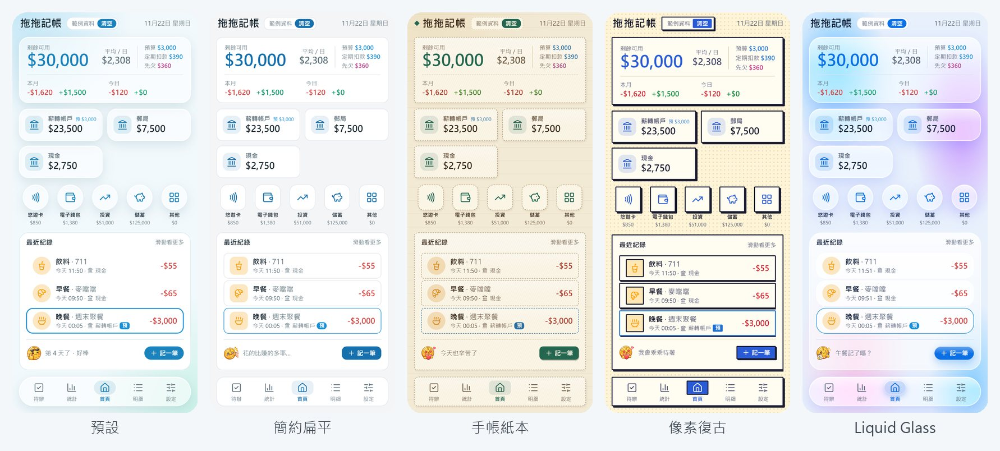

# 拖拖記帳 🪙

> **一拖就記，再也不拖拖拉拉。**

拖拖記帳是一款**用「拖」的就能記帳**的 Android 記帳 App。把卡片拖到想去的地方，一筆帳就記好了。
資料全部留在你自己的手機裡，**不用註冊、不用登入、不用網路**。

[](https://github.com/good60613/tuotuo-ledger/releases/latest)
[](LICENSE)


---

## ✨ 為什麼會喜歡它

- **一拖就記**：長按卡片、拖到目標放開，就記好一筆或轉好帳。為了不誤觸，手勢經過很多次調整。
- **多個帳戶一目了然**：一般帳戶放在首頁，悠遊卡、電子錢包、投資、儲蓄、其他各有一顆小球，點進去有各自的小記帳畫面。
- **一眼看到「還能花多少」**：首頁大大的「剩餘可用」，還幫你算好「平均每天可以花多少」。
- **報帳、先付、先欠、預算**：幫朋友先付、公司報帳、別人欠你、每月預算，都有專屬的待辦清單，不會忘記。
- **打卡日曆**：每天記帳，日曆上會蓋一個章，還有拖拖硬幣幫你加油，看你連續記了幾天。
- **記帳頁很順手**：內建計算機，可以直接輸入算式（例如 `120+85`），分類、標記、備註一頁搞定。
- **五種外觀風格**：想換心情就換風格，亮色、暗色、字體也都能自己選。
- **桌面小工具**：不用打開 App，就能在桌面看到剩餘可用，還能放載具條碼。
- **資料是你的**：隨時匯出備份、匯入；從別的記帳 App 搬家，也有教學可以請 AI 幫你轉。

## 🎨 五種外觀風格



預設、簡約扁平、手帳紙本、像素復古、Liquid Glass。每一種都有亮色與暗色：


> 畫面中的金額都是 App 內建的「範例資料」，不是真實帳目。

## 📲 怎麼下載使用

目前提供 **Android** 版（iPhone 版之後再評估）。

1. 用手機打開 **[最新版本頁面](https://github.com/good60613/tuotuo-ledger/releases/latest)**。
2. 點 `tuotuo-ledger-版本號.apk` 下載。
3. 下載完成後點開，手機若提示「不允許安裝未知來源的應用程式」，請依畫面指示允許這一次（Chrome 或「檔案」App 會出現這個選項）。
4. 安裝完成，打開就能用。第一次會有一段簡短的新手教學，也可以跳過。

**之後怎麼更新？** App 會自己檢查有沒有新版本（一天最多一次），有的話會提醒你，點〔下載更新〕再安裝一次就好，**資料會保留**。不喜歡的話可以到「設定」把〔自動檢查更新〕關掉。

<details>
<summary>想確認 APK 沒有被動過手腳？（進階）</summary>

每一版的 APK 都用同一把金鑰簽章。簽章憑證的 SHA-256 指紋是：

```
42562f0b4a61f3b28e774b5a72dcd25739bb5db84b812db4b587b6d2ef5f8d2e
```

用 Android SDK 的 `apksigner verify --print-certs 檔名.apk` 可以查看，指紋不一樣就不要安裝。

</details>

## 🔒 資料與隱私

- 所有帳目都**只存在你的手機**裡，沒有雲端、沒有帳號、沒有廣告。
- 整個 App 只有兩種情況會連網：**檢查更新**（只問 GitHub 有沒有新版，不會傳送你的任何資料），以及你**自己選擇下載字體**時（從字體的官方 GitHub 下載）。
- 因為資料只在手機裡，**換手機或解除安裝前，請先到「設定」匯出備份**。App 也有自動存檔的功能。

## 🗺️ 未來計畫

- **預計 2027 年初上架 Google Play**，到時候就能直接在商店安裝與更新。
- 持續更新：更多外觀、更多小工具、更完整的說明。
- iPhone 版：之後評估。

（計畫可能會調整，以實際發佈為準。）

## 💬 想回饋或問問題？

歡迎到 [Issues](https://github.com/good60613/tuotuo-ledger/issues) 留言：回報問題、提出想要的功能，或只是說聲「我用了」都很開心。

## 📜 授權與素材

- **程式碼**：[PolyForm Noncommercial 1.0.0](LICENSE)。你可以閱讀、學習、個人使用與自行修改，**不可以拿去商業販售或上架營利**。
- **拖拖硬幣等美術素材**：保留所有權利，詳見 [ASSETS-LICENSE.md](ASSETS-LICENSE.md)。
- 圖示使用 [Lucide](https://lucide.dev)（ISC 授權）。

## 🛠️ 給想看程式的人

使用 Preact、TypeScript、Vite，再用 Capacitor 包成 Android App。怎麼在電腦上跑起來、怎麼打包與發版，都寫在 [開發說明](文件/開發說明.md)。
