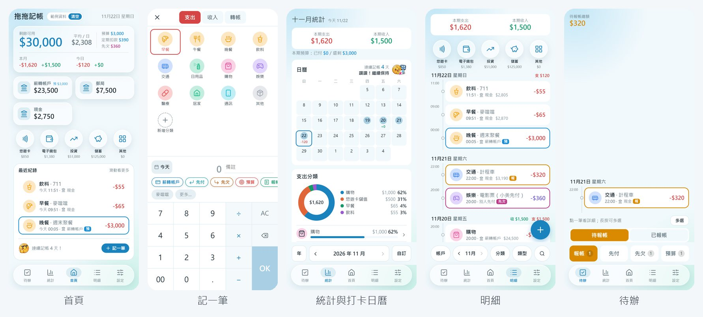
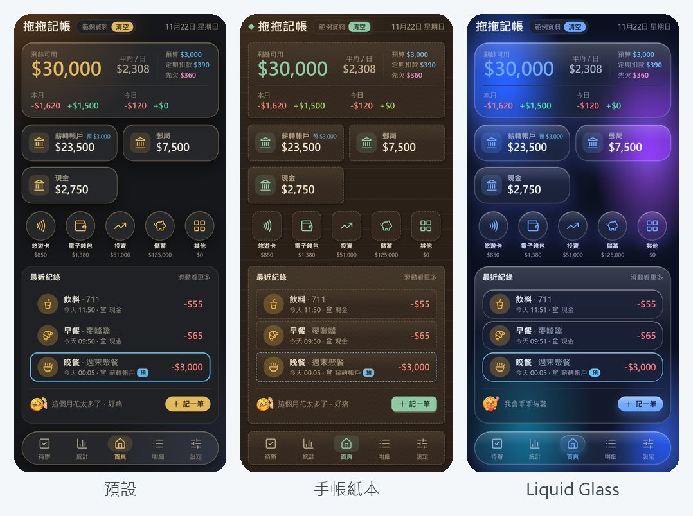

# 拖拖記帳 🪙

> **一拖就記，再也不拖拖拉拉。**

拖拖記帳是一款**用「拖」的就能記帳**的 Android 記帳 App。把卡片拖到想去的地方，一筆帳就記好了。
資料全部留在你自己的手機裡，**不用註冊、不用登入、不用網路**。

[](https://github.com/good60613/tuotuo-ledger/releases/latest)
[](LICENSE)



---

## ✨ 為什麼會喜歡它

- **一拖就記**：長按卡片、拖到目標放開，就記好一筆或轉好帳。為了不誤觸，手勢經過很多次調整。
- **多個帳戶一目了然**：一般帳戶放在首頁，悠遊卡、電子錢包、投資、儲蓄、其他各有一顆小球，點進去有各自的小記帳畫面。
- **一眼看到「還能花多少」**：首頁大大的「剩餘可用」，還幫你算好「平均每天可以花多少」。
- **報帳、先付、先欠、預算**：幫朋友先付、公司報帳、別人欠你、每月預算，都有專屬的待辦清單，不會忘記。
- **打卡日曆**：每天記帳，日曆上會蓋一個章，還有拖拖硬幣幫你加油，看你連續記了幾天。
- **記帳頁很順手**：內建計算機，可以直接輸入算式（例如 `120+85`），分類、標記、備註一頁搞定。
- **五種外觀風格**：想換心情就換風格，亮色、暗色、字體也都能自己選。
- **桌面小工具**：不用打開 App，就能在桌面看到剩餘可用，還能放載具條碼。
- **資料是你的**：隨時匯出備份、匯入；從別的記帳 App 搬家，也有教學可以請 AI 幫你轉。

## 🎨 五種外觀風格


預設、簡約扁平、手帳紙本、像素復古、Liquid Glass。每一種都有亮色與暗色：



> 畫面中的金額都是 App 內建的「範例資料」，不是真實帳目。

## 📲 怎麼下載使用

目前提供 **Android** 版（iPhone 版之後再評估）。

1. 用手機打開 **[最新版本頁面](https://github.com/good60613/tuotuo-ledger/releases/latest)**。
2. 點 `tuotuo-ledger-版本號.apk` 下載。
3. 下載完成後點開，手機若提示「不允許安裝未知來源的應用程式」，請依畫面指示允許這一次（Chrome 或「檔案」App 會出現這個選項）。
4. 安裝完成，打開就能用。第一次會有一段簡短的新手教學，也可以跳過。

**之後怎麼更新？** App 會自己檢查有沒有新版本（一天最多一次），有的話會提醒你，點〔下載更新〕再安裝一次就好，**資料會保留**。不喜歡的話可以到「設定」把〔自動檢查更新〕關掉。

<details>
<summary>想確認 APK 沒有被動過手腳？（進階）</summary>

每一版的 APK 都用同一把金鑰簽章。簽章憑證的 SHA-256 指紋是：

```
42562f0b4a61f3b28e774b5a72dcd25739bb5db84b812db4b587b6d2ef5f8d2e
```

用 Android SDK 的 `apksigner verify --print-certs 檔名.apk` 可以查看，指紋不一樣就不要安裝。

</details>

## 🔒 資料與隱私

- 目前的版本，所有帳目都**只存在你的手機**裡，沒有雲端、沒有帳號、沒有廣告。（之後的計畫見下方「未來計畫」，有變動我會在這裡同步說明。）
- 整個 App 只有兩種情況會連網：**檢查更新**（只問 GitHub 有沒有新版，不會傳送你的任何資料），以及你**自己選擇下載字體**時（從字體的官方 GitHub 下載）。
- 因為資料只在手機裡，**換手機或解除安裝前，請先到「設定」匯出備份**。App 也有自動存檔的功能。

## 🗺️ 未來計畫

- **預計 2027 年初上架 Google Play**，到時候就能直接在商店安裝與更新。
- **選用的 Google 帳號備份**：把備份存到你自己的 Google 帳號，換手機更方便。不使用就維持現在的「只存手機」，完全不用登入。
- **上架 Google Play 後會加入廣告與「拖拖＋」訂閱**：廣告會盡量克制、可以關掉；訂閱是選用的，不訂閱也能正常記帳。細節確定後會公布在這裡。
- 持續更新：更多外觀、更多小工具、更完整的說明。
- iPhone 版：之後評估。

（計畫可能會調整，以實際發佈為準。）

## 💬 想回饋或問問題？

歡迎到 [Issues](https://github.com/good60613/tuotuo-ledger/issues) 留言：回報問題、提出想要的功能，或只是說聲「我用了」都很開心。

## 📜 授權與素材

- **程式碼**：[PolyForm Noncommercial 1.0.0](LICENSE)。你可以閱讀、學習、個人使用與自行修改，**不可以拿去商業販售或上架營利**。
- **拖拖硬幣等美術素材**：保留所有權利，詳見 [ASSETS-LICENSE.md](ASSETS-LICENSE.md)。
- 圖示使用 [Lucide](https://lucide.dev)（ISC 授權）。

---

# 🛠️ 技術說明（給開發者）

以下是給想在電腦上跑、改、打包拖拖記帳的人。一般使用者不用看。

技術：Preact 10、TypeScript、Vite、Vitest；用 Capacitor 8 包成 Android App。

## 在電腦上跑起來

需要 Node.js（本機開發用的版本是 24）。

```
npm install
npm run dev
```

網頁預覽預設在 `http://localhost:5173/`。想用手機看：手機與電腦連**同一個 Wi-Fi**，用手機 Chrome 打開終端機印出的 `Network:` 網址（Windows 防火牆詢問時按「允許」）。Windows 上也可以直接雙擊 `start-dev.bat`。

> 網頁版的資料存在瀏覽器裡，跟著「網址」走，換網址（例如換 Wi-Fi）就是一份新的空資料。換之前請先在「設定」匯出備份。

開發模式專用的預覽參數（正式版沒有）：

| 網址參數 | 用途 |
|---|---|
| `?style=glass｜flat｜paper｜pixel｜liquid` | 直接套用某個外觀風格（不存進設定） |
| `&theme=light｜dark｜system` | 直接套用亮／暗色 |
| `?splash=hold` | 開啟動畫停在畫面上，方便檢查 |

## 常用指令

| 指令 | 用途 |
|---|---|
| `npm run dev` | 開發伺服器（同 `start-dev.bat`） |
| `npm run typecheck` | 型別檢查 |
| `npm test` | 自動檢查（計算規則、報帳流程、備份、動畫、風格、更新檢查…） |
| `npm run build` | 建置網頁到 `dist/` |

## 微調手感與動畫

- 手勢數值（長按時間、移動門檻、換頁距離、震動長度、拖曳時卡片大小…）：`src/config.ts`，改完存檔，手機重新整理就會生效。
- 動畫數值（各風格的進退場時間與曲線）：`src/motion.ts`。

## 資料夾結構

```
src/
  config.ts          手勢、版面、更新檢查等設定
  motion.ts          動畫數值與離場殘影
  theme.ts           顏色（亮／暗＋各風格微調）
  uiStyle.ts         外觀風格切換
  styles.css         基礎樣式；styles/ui-*.css 是各風格的覆蓋樣式
  data/              資料格式、計算規則、記帳／報帳操作、儲存、備份、範例資料
  gestures/          卡片拖曳、左右換頁、震動、防誤觸護盾
  pages/             五個主頁面、記帳頁、小帳戶頁
  components/        卡片、小球、計算機、時間軸、圖表、選單
  help/              App 內的使用說明
tests/               自動檢查
android/             Android 原生專案（Capacitor）、桌面小工具
tools/               打包與圖片處理小工具
文件/                更新紀錄、設計說明、各種說明文件
工單/                每一版的施工紀錄
```

## 打包與發版

- **在電腦上打包 APK**：雙擊 `打包APK.bat`（簽章金鑰放在專案外面的資料夾，不進 git）。詳細步驟見 [更新流程](文件/更新流程.md)。
- **用 GitHub 自動打包、發版**（含用手機開發的做法）：見 [GitHub 使用說明](文件/GitHub使用說明.md)。推到 `v` 開頭的分支會自動打出試用 APK；推 `v3.x.x` 格式的 tag 會自動發 Release。

重要提醒：

- 每次發版，`android/app/build.gradle` 的 `versionCode` 一定要比上一版大，`versionName` 要跟 tag 對得上（例如 tag `v3.4.0` 對 `3.4.0`）。
- 簽章金鑰與密碼絕對不要放進 git；每一版必須用同一把金鑰簽，否則手機無法覆蓋安裝。
- Windows 上改含中文的檔案，請用編輯器或 `Edit` 類工具，不要用 PowerShell 5.1 的 `Get-Content`／`Set-Content` 重寫（會把中文寫壞或加上 BOM）。

## 已知限制

- iPhone 版尚未提供；iPhone 的瀏覽器不支援震動（網頁版的視覺回饋仍有）。

## 更多文件

| 文件 | 內容 |
|---|---|
| [更新紀錄](文件/更新紀錄.md) | 每一版改了什麼 |
| [設計說明](文件/設計說明.md) | 設計想法與決定 |
| [小工具說明](文件/小工具說明.md) | 桌面小工具如何取得數字與更新 |
| [技術審查報告](文件/技術審查報告.md) | 技術面的檢查結果 |
| [`工單/`](工單/) | 每一版的施工工單與紀錄 |
